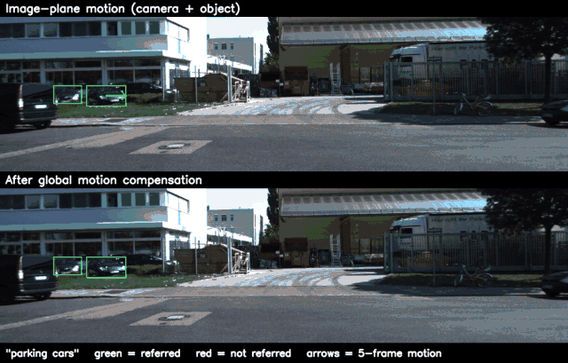
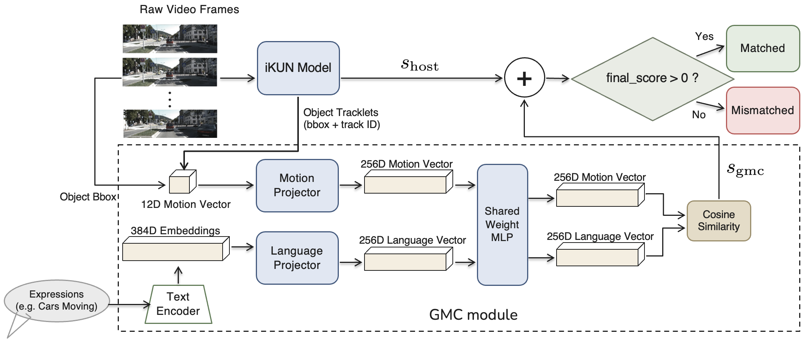

# Referring Multi-Object Tracking in Moving-Camera Videos via Global Motion Compensation

Hsin-Chen Pai, Jyun-Kai Wang, Yi-Cheng Peng, Wei-Ta Chu · National Cheng Kung University

[](https://arxiv.org/abs/2610.04185)
[](https://github.com/Seanachan/GMC-RMOT/actions/workflows/tests.yml)
[](LICENSE)

Code and weights for the **GMC module**: a plug-in that gives a referring multi-object tracking (RMOT) model camera-motion-compensated motion cues. You do not retrain or modify the host model.

In video from a moving car, a parked vehicle sweeps across the image while a vehicle driving alongside barely moves. RMOT methods that read motion from box displacement see this inverted picture. The GMC module estimates the camera's motion, removes it from each track's displacement, and matches the remaining *residual* motion against the expression ("moving cars", "left vehicles which are parking"). Its score is added to the host's score.

<p align="center"></p>

<p align="center"><sub>Refer-KITTI 0001, camera turning, expression "parking cars". Arrows show 5-frame motion. Top: image-plane motion, dominated by the camera. Bottom: residual after global motion compensation, the feature the module actually uses.</sub></p>

## Method



1. **Camera motion.** Shi-Tomasi corners on the road (lower half of the frame, tracked boxes masked out) are followed with pyramidal Lucas-Kanade flow. RANSAC fits the frame-to-frame homography, and the homographies are composed over up to 10 frames. A global ORB fit is the fallback; on Refer-KITTI it never fires. → [`gmc/ego.py`](gmc/ego.py)
2. **Multi-scale residual velocity.** Raw centroid displacement minus the displacement the camera alone would cause, at gaps of 2, 5 and 10 frames. With box size, size change and position this gives a 12-D motion feature. A track is scored only after 11 frames of history; before that the module abstains. → [`gmc/manager.py`](gmc/manager.py)
3. **Motion-language matching.** Linear adapters plus a shared MLP map the motion feature and a frozen MiniLM sentence embedding into one 256-D space. Training uses symmetric InfoNCE, and the match score is the cosine similarity `s_gmc`. → [`gmc/aligner.py`](gmc/aligner.py), [`gmc/train.py`](gmc/train.py)
4. **Late fusion.** `s_final = s_host + α_c · s_gmc`. `α_c` takes one value for moving/static expressions and another for the rest, chosen per host by leave-one-sequence-out cross-validation. `α = 0` gives back the host exactly. → [`gmc/fusion.py`](gmc/fusion.py)

The module costs 6.7 ms per frame on CPU (149 FPS), not counting the host.

## Results

Refer-KITTI V1 uses the official 150-expression test list (3 sequences); Refer-KITTI-V2 has 4 test sequences. *+ GMC* is the mean over three training seeds. *Host* is the same pipeline with `α = 0`, our run of each method's official code.

**Pooled HOTA** (all expressions)

| Host | Benchmark | Host | + GMC |
|---|---|---:|---:|
| iKUN | Refer-KITTI | 44.54 | **45.30** |
| TransRMOT | Refer-KITTI | 45.76 | **46.15** |
| FlexHook | Refer-KITTI | 53.82 | **53.98** |
| FlexHook | Refer-KITTI-V2 | 42.53 | **42.63** |

**Moving-class HOTA** (21 of 150 V1 expressions, 111 of 862 V2 expressions)

| Host | Host | Gain (± std, 3 seeds) |
|---|---:|---:|
| iKUN | 27.70 | **+9.44 ± 0.92** |
| TransRMOT | 33.88 | +1.43 ± 0.13 |
| FlexHook V2 | 38.56 | +0.69 ± 0.04 |
| FlexHook V1 | 47.90 | +0.43 ± 0.19 |

The gain is largest where the host's own motion understanding is weakest.

**Ablation** (iKUN, 5 seeds, one shared α = 0.35 for all classes)

| Variant | Moving HOTA | Pooled HOTA |
|---|---:|---:|
| iKUN alone | 27.70 | 44.54 |
| Full module | **36.99** | **45.28** |
| − camera-motion compensation (raw velocity) | 32.37 | 44.61 |
| − multi-scale (single 5-frame gap) | 35.14 | 45.00 |

Both drops are significant (Welch's t-test, p < 0.01). See the [paper](https://arxiv.org/abs/2610.04185) for DetA/AssA and the full protocol.

## Installation

```bash
git clone https://github.com/Seanachan/GMC-RMOT.git
cd GMC-RMOT
pip install -e .          # Python >= 3.9, PyTorch, OpenCV, sentence-transformers
```

Pretrained aligner weights, one per training seed (2.5 MB each), are on the [v1.0.0 release](https://github.com/Seanachan/GMC-RMOT/releases/tag/v1.0.0):

```bash
mkdir -p weights
gh release download v1.0.0 --repo Seanachan/GMC-RMOT --dir weights --pattern "*.pth"
```

## Use with your own tracker

```python
from gmc import GMCManager, PAPER_WEIGHTS, fuse
from gmc.text import TextEncoder

gmc = GMCManager("weights/gmc_aligner_seed0.pth")
text = TextEncoder().encode("moving cars")            # (1, 384)
alpha = PAPER_WEIGHTS["ikun"].for_expression("moving cars")

for frame, tracks in video:                           # tracks: [(track_id, x, y, w, h), ...] in pixels
    s_gmc = gmc.process_frame(frame, tracks, text)    # {track_id: cosine}; warming-up tracks are absent
    for track_id, *_ in tracks:
        s_final = fuse(host_score[track_id], s_gmc.get(track_id), alpha)
```

Call `gmc.reset()` between videos. For many expressions on the same video, call `gmc.update(frame, tracks)` once per frame, then score each expression against the stored embeddings, as [`scripts/build_gmc_scores.py`](scripts/build_gmc_scores.py) does. Host scores live on different scales, so pick `α` per host: Table 1 values are in `gmc.PAPER_WEIGHTS`, and for a new host, select on held-out sequences.

## Reproduce the iKUN results

KITTI and Refer-KITTI are under a non-commercial license and are not redistributed here.

1. **Refer-KITTI** from the [RMOT repository](https://github.com/wudongming97/RMOT): `expression/`, `KITTI/training/image_02/`, `KITTI/labels_with_ids/`, `gt_template/`.
2. **iKUN files** from the [iKUN repository](https://github.com/dyhBUPT/iKUN) (its "prepared files"): `NeuralSORT/`, `textual_features.json`, `iKUN_cascade_attention.pth`. Run iKUN's own test script with cascade attention and *without* `--similarity_calibration`; `eval_ikun.py` applies the calibration itself:
   ```bash
   python test.py --kum_mode 'cascade attention' --test_ckpt iKUN_cascade_attention.pth   # -> results.json
   ```
3. **TrackEval** from [TempRMOT](https://github.com/zyn213/TempRMOT). Its seqmap reader understands `sequence+expression` entries. It reads sequence lengths from a hard-coded frame directory (`TrackEval/trackeval/datasets/mot_challenge_2d_box.py`, line 186); point that line at your `KITTI/training/image_02`.

Then, for each seed:

```bash
python scripts/build_gmc_scores.py --data-root $REFER_KITTI --tracks $IKUN/NeuralSORT \
    --weights weights/gmc_aligner_seed0.pth --out scores/seed0

python scripts/eval_ikun.py --ikun-root $IKUN_REPO --data-root $REFER_KITTI \
    --tracks $IKUN/NeuralSORT --ikun-scores $IKUN/results.json \
    --text-feat $IKUN/textual_features.json --gt-template $REFER_KITTI/gt_template \
    --trackeval $TEMPRMOT/TrackEval --gmc-scores scores/seed0 --out runs/ikun_seed0
```

Expected output (HOTA on the official 150-expression list), from running this release:

| | Pooled | Moving | Static | Appearance |
|---|---:|---:|---:|---:|
| iKUN alone (`--alpha-mot 0 --alpha-oth 0`) | 44.543 | 27.697 | 43.914 | 46.300 |
| + GMC, seed 0 | 45.288 | 37.018 | 44.699 | 46.337 |
| + GMC, seed 1 | 45.426 | 38.116 | 44.695 | 46.422 |
| + GMC, seed 2 | 45.197 | 36.282 | 44.357 | 46.356 |
| **+ GMC, mean** | **45.304** | **37.139** | | |

## Train

```bash
python -m gmc.train --data-root $REFER_KITTI --seed 0 --save-path weights/my_aligner_seed0.pth
```

Training uses the 15 Refer-KITTI V1 training sequences: AdamW, lr 1e-3 with cosine decay, batch 256, 100 epochs. The first run caches the training pairs under `cache/`. Ablations: `--no-ego` (raw velocity) and `--gaps 5,5,5` (single gap). Pass the same `frame_gaps` / `compensate_ego` to `GMCManager`; it refuses weights trained with different settings. The released weights are the ones behind the numbers above. A fresh run lands close to them but not bit-for-bit, because GPU training is nondeterministic.

## Other hosts

The module only needs the host's tracks (boxes + ids per frame), the video frames, and the host's per-track score for each expression. The paper also plugs it into [TransRMOT](https://github.com/wudongming97/RMOT) and [FlexHook](https://arxiv.org/abs/2503.07516) in the same way:

1. Run the host and keep its per-(frame, track, expression) score before thresholding.
2. Compute `s_gmc` on the host's own tracks, as `build_gmc_scores.py` does for NeuralSORT.
3. Keep a track iff `s_host + α · s_gmc` exceeds the host's own threshold, with `α` from `PAPER_WEIGHTS["transrmot" | "flexhook_v1" | "flexhook_v2"]`.

Evaluate against ground truth whose frame numbering matches the host's tracker output. TransRMOT and NeuralSORT number frames differently, and an off-by-one mismatch silently lowers HOTA.

## Tests

```bash
pytest
```

79 tests. 7 of them need Refer-KITTI (set `REFER_KITTI_ROOT`), and one of those also needs a CUDA GPU, so CI skips them. The other 72 run on synthetic moving-camera footage. They check that camera motion is recovered, that a static object under a panning camera gets near-zero residual velocity, the warm-up rule, the training-pair builder, the fusion rule, and that 21 of the 150 official test expressions fall in the moving class.

## Limitations

- The road-plane homography assumes a flat road; steep or uneven ground is out of scope.
- Box centres sit above the road plane, so under forward camera motion some parallax survives compensation. Rotation, by contrast, is removed exactly.
- Direction and turning expressions ("turning cars", "cars faster than ours") use the other-class weight, so the module does not help them even though they describe motion.
- Only evaluated on Refer-KITTI and Refer-KITTI-V2.

## Citation

```bibtex
@article{pai2026gmc,
  title   = {Referring Multi-Object Tracking in Moving-Camera Videos via Global Motion Compensation},
  author  = {Pai, Hsin-Chen and Wang, Jyun-Kai and Peng, Yi-Cheng and Chu, Wei-Ta},
  journal = {arXiv preprint arXiv:2610.04185},
  year    = {2026}
}
```

## Acknowledgements

Built on [Refer-KITTI / TransRMOT](https://github.com/wudongming97/RMOT), [iKUN](https://github.com/dyhBUPT/iKUN), [TempRMOT](https://github.com/zyn213/TempRMOT), [FlexHook](https://arxiv.org/abs/2503.07516), [TrackEval](https://github.com/JonathonLuiten/TrackEval) and [sentence-transformers](https://www.sbert.net/). Code is MIT-licensed. Datasets and third-party models keep their own licenses.
